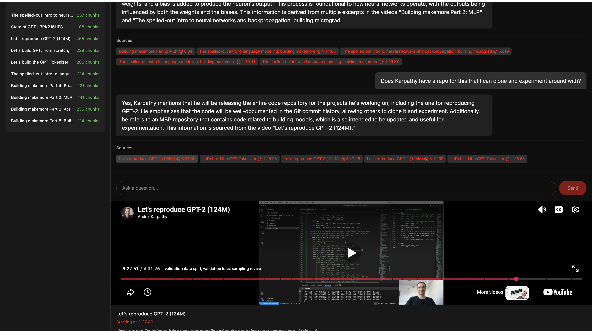
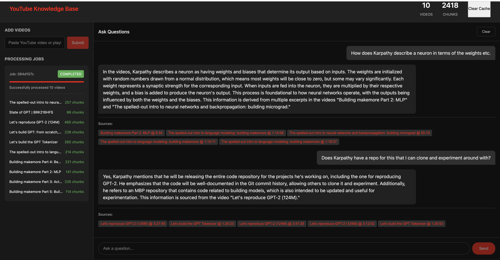
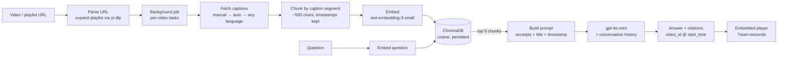

# YouTube Knowledge Base

Turn a YouTube video or playlist into a searchable knowledge base: ask questions in plain English and get answers that link to the exact moments in the videos they came from. Built for people learning from long-form technical content, such as lecture series, course playlists, and multi-hour coding walkthroughs.

## Demo

<!-- TODO: record a short walkthrough (submit playlist -> ask question -> click citation) and save it as docs/demo.gif -->
<!--  -->



*A 10-video, 2,418-chunk index of Andrej Karpathy's neural-network lectures. Clicking a source opens the embedded player at that moment (3:27:49 into a 4-hour video).*

<details>
<summary>Ingestion and follow-up questions</summary>



</details>

## Features

- **Video and playlist ingestion.** Paste a video, playlist, `youtu.be`, or embed URL. Playlists are expanded into their individual videos.
- **Caption extraction with fallback.** Manual captions are preferred. If there are none, auto-generated captions are used, then any language available.
- **Background indexing.** Submitting returns a job ID right away. Videos are indexed concurrently, with live per-video progress in the UI.
- **Rate-limit-aware processing.** If YouTube or OpenAI starts rate limiting, the job falls back to less concurrent processing instead of failing.
- **Semantic search** over all indexed transcripts, using OpenAI embeddings stored in a persistent ChromaDB collection.
- **Answers with timestamp citations.** Each source opens an embedded player at the matching moment in the video.
- **Follow-up questions.** The last 10 messages of the conversation are sent with each new question.
- **Caching.** Video metadata, captions, and playlist listings are cached on disk with expiry times, so re-submitting a video doesn't hit YouTube again.
- **REST API** with interactive Swagger docs. The UI is built entirely on this API.

## How it works



**Ingestion.** `POST /api/videos` parses the URL. For a playlist, it lists the video IDs with yt-dlp in flat mode, which avoids fetching every video's full metadata up front. It then starts a background job and returns immediately. For each video, the job fetches metadata, gets a transcript, chunks it, embeds all chunks in one batched OpenAI call, and upserts them into ChromaDB.

**Querying.** `POST /api/query` embeds the question and retrieves the 5 nearest chunks. Each chunk goes into the prompt as a numbered excerpt with its video title and timestamp, and the prompt is sent to `gpt-4o-mini` along with the recent conversation. The response includes the answer and one citation per retrieved chunk (video ID, title, start time, YouTube link, and a snippet of the text).

## Design decisions and tradeoffs

**Chunk by caption segment, not by raw character offset.** YouTube returns a transcript as hundreds or thousands of short segments, each with a `start` and `duration`. The chunker builds each chunk from whole segments until it reaches `chunk_size` characters. So every chunk has exact timestamps: it starts at its first segment's `start` and ends at its last segment's `start + duration`. That's what makes citations land on the right second without any alignment step afterwards. A chunk can run slightly over `chunk_size`, since segments are never split.

**500-character chunks, 50-character overlap.** I chose small chunks on purpose. Each chunk covers roughly one idea, so its embedding matches specific questions closely, and a citation points to a 15–30 second window instead of several minutes. The cost is less context per chunk, so an explanation that spans a few minutes can be split across chunks that aren't all retrieved. The overlap carries over only whole trailing segments that fit within 50 characters. In practice it's often a single short segment, which keeps duplicate text (and wasted retrieval slots) low. Both values can be configured through `YKB_CHUNK_SIZE` and `YKB_OVERLAP`. My notes on the tradeoffs are in [docs/repo-analysis.md](docs/repo-analysis.md).

**Captions over speech-to-text.** Almost every YouTube video has at least auto-generated captions, and fetching them is free and instant. Transcribing audio costs money and takes minutes per hour of video. The fallback order is: manual captions in a preferred language (`en`, `en-US`, `en-GB`), then auto-generated captions in a preferred language, then any track in any language. Manual captions come first because they're punctuated and accurate on technical terms, which matters for both embedding quality and the snippets shown to users. Videos with no captions at all are skipped and shown as not indexed, so one bad video doesn't fail the whole job.

**Citations map back to timestamps through chunk metadata, not the LLM.** Each chunk's `video_id`, `start_time`, `end_time`, and video title are stored as ChromaDB metadata next to its embedding. Citations are built from the retrieved chunks' metadata, never parsed from the model's text, so a timestamp can't be hallucinated. The frontend loads the YouTube embed with `?start=<seconds>`. The tradeoff: the sources show what was *retrieved*, not which specific excerpts the answer *relied on* (see Next steps).

**Background jobs that degrade under rate limits.** Indexing a 10-video playlist means dozens of calls to YouTube and OpenAI, too slow to do inside a request. Jobs run as asyncio tasks, and the blocking work (yt-dlp, the transcript API, OpenAI, ChromaDB) runs in threads via `asyncio.to_thread`, so the API stays responsive. Each job tries three strategies in order:

1. fully parallel (`asyncio.gather`)
2. bounded parallel (a semaphore of 3)
3. sequential

It moves to the next strategy **only** when a rate limit is detected, and then retries only the videos that aren't indexed yet. Any other error is recorded against that video and the job continues. Rate-limit detection recognises OpenAI `RateLimitError`, YouTube transcript-API blocking, and yt-dlp 429s. It also follows the chain of wrapped exceptions (`__cause__`), because the service layers wrap low-level errors in their own exception types.

**Deterministic chunk IDs.** Chunk IDs are an MD5 hash of `video_id:chunk_index:start_time`, and writes use upsert. Re-indexing a video with the same settings overwrites its chunks instead of duplicating them.

**Retrieval uses the current question only.** Conversation history goes to the LLM so it can resolve follow-ups like "does he have a repo for this?". Retrieval, though, embeds only the latest question. This keeps search results from drifting towards earlier topics. The cost is that a follow-up that is very vague on its own can retrieve weaker chunks.

**Caching by data type.** Metadata (7 days), captions (30 days), and playlist listings (1 day) are cached in `diskcache` with different expiry times, because they change at different rates. Playlists get new videos; captions almost never change. All expiry times are configurable in `backend/config/settings.py`.

## Tech stack

| Layer | Technology |
| --- | --- |
| API | FastAPI, Pydantic v2, Uvicorn |
| YouTube | yt-dlp (metadata, playlists), youtube-transcript-api (captions) |
| Embeddings | OpenAI `text-embedding-3-small` |
| Vector store | ChromaDB (persistent, cosine HNSW) |
| LLM | OpenAI `gpt-4o-mini` |
| Caching | diskcache |
| Frontend | React 19, Vite 7 |
| Testing | pytest, pytest-asyncio, httpx |

## Getting started

### Prerequisites

- [uv](https://docs.astral.sh/uv/) (`brew install uv` or `curl -LsSf https://astral.sh/uv/install.sh | sh`)
- Python 3.12 (installed through uv below)
- Node.js 20.19+ or 22.12+ (required by Vite 7)
- An OpenAI API key

### Setup

From the project root:

```bash
# Python environment
uv python install 3.12
uv venv --python 3.12
source .venv/bin/activate
uv pip install -r requirements.txt

# Environment variables
cp .env.example .env        # then set OPENAI_API_KEY

# Frontend dependencies
cd frontend && npm install && cd ..
```

`.env` supports:

| Variable | Required | Default | Purpose |
| --- | --- | --- | --- |
| `OPENAI_API_KEY` | yes | | Embeddings and chat completions |
| `YKB_CHUNK_SIZE` | no | `500` | Target chunk size in characters |
| `YKB_OVERLAP` | no | `50` | Maximum overlap between chunks in characters |

Changing the chunk settings only affects videos indexed afterwards. Use **Clear Cache** before re-indexing, or the old chunks will stay in the index next to the new ones.

### Run

```bash
# Terminal 1: backend, http://localhost:8000
source .venv/bin/activate
python -m uvicorn backend.api.app:app --reload

# Terminal 2: frontend, http://localhost:3000
cd frontend
npm run dev
```

- App: http://localhost:3000. The Vite dev server proxies `/api` to the backend.
- API docs: http://localhost:8000/docs

<details>
<summary>Virtual environment tips</summary>

- Activate in every new terminal with `source .venv/bin/activate`, leave with `deactivate`.
- Or skip activation and prefix commands with `uv run`, for example `uv run uvicorn backend.api.app:app --reload`.
- Add a dependency: put it in `requirements.txt`, then `uv pip install -r requirements.txt`.
- Rebuild a broken venv: `rm -rf .venv && uv venv --python 3.12 && source .venv/bin/activate && uv pip install -r requirements.txt`.
- VS Code: run *Python: Select Interpreter* and pick `./.venv/bin/python`.

</details>

Indexed data is stored in `.cache/`: ChromaDB in `.cache/chroma`, cached metadata and captions in `.cache/video_processor`. Delete that folder for a clean slate.

## Testing

```bash
source .venv/bin/activate
python -m pytest tests/ -v
```

| File | Tests | Covers | Needs network |
| --- | --- | --- | --- |
| `test_video_processor.py` | 19 | URL parsing (watch, short, embed, playlist, timestamped), metadata, caption fetching, cache management | YouTube |
| `test_embeddings.py` | 13 | Chunking (timestamps kept, sequential indices, edge cases), indexing, deletion, search with video filters | OpenAI |
| `test_query_engine.py` | 13 | Citation formatting, conversation history trimming, end-to-end answering, the no-results case | OpenAI |
| `test_api.py` | 9 | Health, video submission and validation, job status, query validation, stats, clearing history | OpenAI |
| `test_transcription.py` | 7 | Transcript retrieval, timestamps, caching, caption availability | YouTube |
| `test_job_strategies.py` | 6 | Parallel → bounded → sequential fallback under simulated rate limits, rate-limit detection through wrapped exceptions | No (mocked) |

These are mostly integration tests that call the real APIs: OpenAI-backed tests are skipped when `OPENAI_API_KEY` isn't set. The chunking, embedding, and query tests use made-up caption data, so their results are deterministic. The YouTube-backed tests fetch a real public video. YouTube blocks transcript requests from cloud-provider IPs and from IPs that send too many requests, so those tests can fail with `IpBlocked` on CI runners or after heavy use. That failure comes from the network, not the code.

## Project structure

```
backend/
  api/
    app.py               # FastAPI app, service wiring, startup/shutdown
    routes.py            # REST endpoints (/videos, /jobs, /query, /stats, /cache)
    jobs.py              # Background job manager and rate-limit fallback strategies
    schemas.py           # Request/response models
  services/
    video_processor.py   # URL parsing, yt-dlp metadata, caption fetching, disk cache
    transcription.py     # Transcript interface over the caption fallback chain
    embeddings.py        # Timestamp-preserving chunking, OpenAI embeddings, ChromaDB
    query_engine.py      # Retrieval, prompt construction, LLM call, citations, history
  models/video.py        # Domain models (captions, segments, metadata)
  config/settings.py     # Settings (YKB_* env vars, cache expiry times)
frontend/src/
  components/            # Submit form, job status, chat, video player, stats
  services/api.js        # API client
tests/                   # pytest suite (see Testing)
docs/                    # Screenshots, design notes, original spec
```

## Next steps and known limitations

- **Citations show what was retrieved, not what was used.** All 5 retrieved chunks are listed, including ones the answer didn't use. The next step is to link each sentence of the answer to its supporting chunk after the answer is generated, using embedding similarity, so individual claims are clickable.
- **Videos without captions are skipped.** `VideoProcessor.extract_audio` can already download audio with yt-dlp. Adding Whisper transcription would cover the remaining videos.
- **Job state and conversation history live in memory.** The ChromaDB index survives a restart, but the job list and the "Videos" count in the header don't. There is a single conversation history shared by every client. Moving jobs to SQLite and keeping history per session would fix both.
- **Search can't be limited to specific videos from the UI.** The `/api/query` endpoint accepts a `video_ids` filter, but the UI doesn't expose it yet.
- **No authentication, and CORS is open.** This is fine for running locally but not for deployment.
